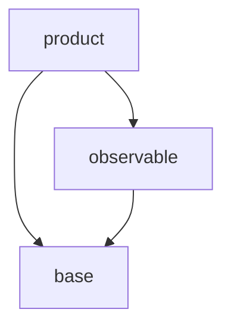

# Economic Model

`economic-model` は、金融商品の経済条件を表現する Kotlin の共有ドメインモデルです。
RFQ Service と Pricing Service で共用し、FINOS Common Domain Model（CDM）の考え方を参考にしながら、必要なコンポーネントを独自に実装します。

## パッケージ構成

商品種別ではなく、金融上の概念と責務に基づいて `base`、`observable`、`product` に分類します。
以下は採用する構成です。`Price.kt` は今後実装する予定のファイルであり、現時点での実装済みファイルを意味しません。

```text
economic-model/
└── src/
    ├── main/kotlin/com/example/economic/
    │   ├── base/
    │   │   ├── datetime/
    │   │   │   ├── BusinessCenter.kt
    │   │   │   ├── BusinessDayConvention.kt
    │   │   │   ├── BusinessDayAdjustments.kt
    │   │   │   ├── DayCountFraction.kt
    │   │   │   ├── Frequency.kt
    │   │   │   ├── RollConvention.kt
    │   │   │   └── ScheduleFrequency.kt
    │   │   ├── math/
    │   │   │   ├── Measure.kt
    │   │   │   ├── Quantity.kt
    │   │   │   └── ValueSchedule.kt
    │   │   └── party/
    │   │       ├── CounterpartyRole.kt
    │   │       └── PayerReceiver.kt
    │   ├── observable/
    │   │   ├── index/
    │   │   │   └── RateIndex.kt
    │   │   └── price/
    │   │       └── Price.kt (planned)
    │   └── product/
    │       ├── EconomicTerms.kt
    │       ├── schedule/
    │       │   ├── CalculationPeriodDates.kt
    │       │   ├── PaymentDates.kt
    │       │   ├── PaymentDaysOffset.kt
    │       │   └── StubSpecification.kt
    │       ├── rate/
    │       │   ├── RateSpecification.kt
    │       │   ├── FloatingRateDetermination.kt
    │       │   ├── ObservationRule.kt
    │       │   ├── FixingDateRule.kt
    │       │   └── RateChangeSchedule.kt
    │       └── payout/
    │           └── Payout.kt
    └── test/kotlin/com/example/economic/
        └── ... (main と対応するパッケージ構成)
```

## 責務

| パッケージ | 責務 |
| --- | --- |
| `base.datetime` | 日付・時間・頻度・営業日調整・日数計算など、商品に依存しない時間の規約 |
| `base.math` | 単位付き数値、数量、値のスケジュールなど、経済条件を記述するための基礎型 |
| `base.party` | 契約当事者の役割、支払方向 |
| `observable.index` | 金利指数・将来の為替指数等、観測対象の識別 |
| `observable.price` | 金融上の価格・レートを表す型（将来実装） |
| `product` | 商品の経済条件全体。複数の `Payout` を組み合わせる |
| `product.schedule` | 契約の計算期間・支払日・Stub 等のスケジュール条件 |
| `product.rate` | 契約における固定・変動金利の指定とその決定規約 |
| `product.payout` | 商品を構成する経済的支払義務。現在は `InterestRatePayout` |

`ValueSchedule` は `MeasureSchedule` や将来の価格スケジュールからも利用するため、`product.schedule` ではなく `base.math` に配置します。現行の `PeriodBasedSchedule` における番号の解釈は各契約の計算期間に従い、基礎型から商品クラスを参照しません。

## 依存関係



- 矢印は利用する側から利用される側への依存を表します。
- `base` は `observable` や `product` を参照しません。
- `observable` は `product` を参照しません。
- 同一グループ内でも原則として循環依存を作らず、必要な基礎概念を別の型に切り出します。
- 市場データの取得、スケジュールの実展開、価格計算エンジン、永続化、通信、Spring Boot の設定は、このモデルの契約条件とは区別します。

## 新しいコンポーネントを配置するとき

1. 商品を知らずに意味が成立する基礎概念なら `base`。
2. 市場で観測・参照する対象や価格の表現なら `observable`。
3. 特定の契約における観測方法、支払条件、ペイアウト、商品全体の条件なら `product`。

例えば、金利指数の識別子は `observable.index`、その指数をどのように観測・集約して契約金利を決めるかは `product.rate` に置きます。将来トリガーを追加する際も、観測値・条件の概念と、契約に適用される効果は区別して配置を検討します。

Kotlin の `sealed interface` / `sealed class` の直接の実装型は、同じパッケージかつ同じモジュールに置く必要があります。例えば、`Payout` と `InterestRatePayout` はともに `product.payout` に所属させます。今後 `Payout.kt` を複数のファイルに分割しても、この制約を維持します。

## 開発方針

- モデルは CDM の全構造をそのまま複製せず、必要な概念から追加する。
- Economic Model は両サービスに共通する契約表現（Shared Kernel）とし、サービス固有の Onion Architecture のレイヤーはここに持ち込まない。
- 商品名ごとのパッケージ分割や、用途が曖昧な `util` / `common` パッケージの追加は、具体的な必要性が生じるまで避ける。
- テストは対応するパッケージに配置し、ドメイン不変条件と失敗条件を検証する。今回のパッケージ移動では振る舞いを変更しない。

```sh
./gradlew :economic-model:test
```

## 参考

- [FINOS CDM — Namespace](https://cdm.finos.org/docs/next/namespace/)
- [FINOS CDM — Rune source](https://github.com/finos/common-domain-model/tree/master/rosetta-source/src/main/rosetta)
- [Kotlin — Sealed classes and interfaces](https://kotlinlang.org/docs/sealed-classes.html)
